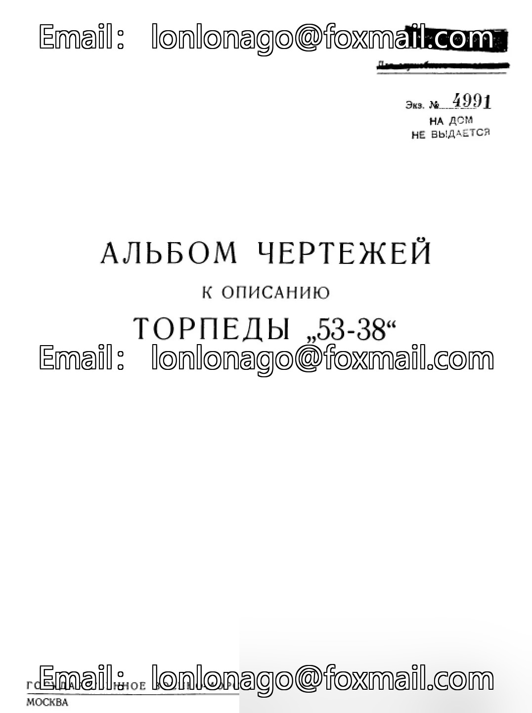
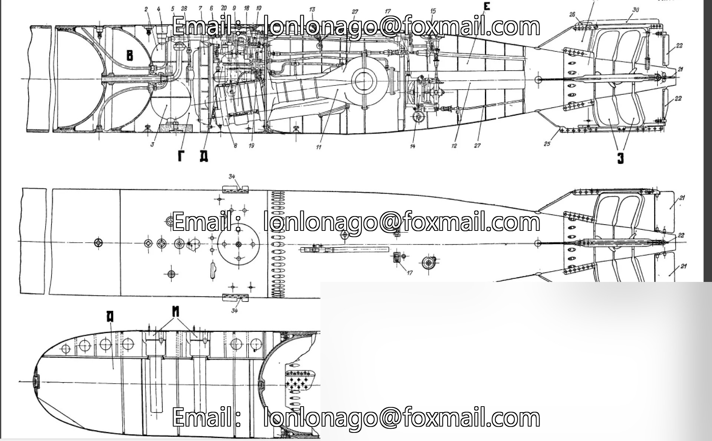
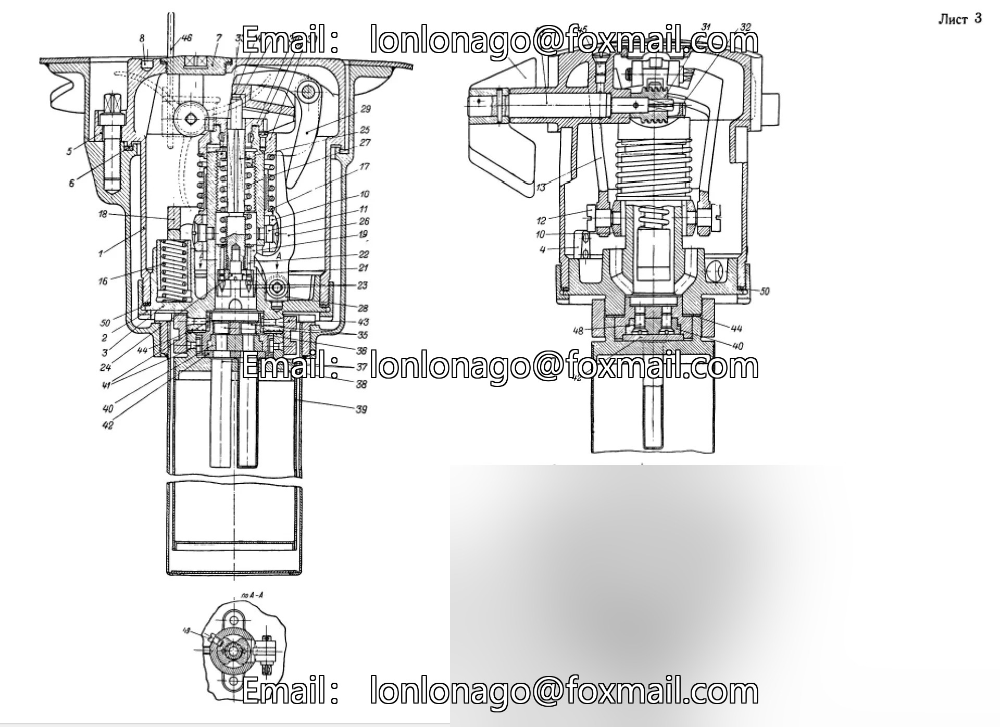
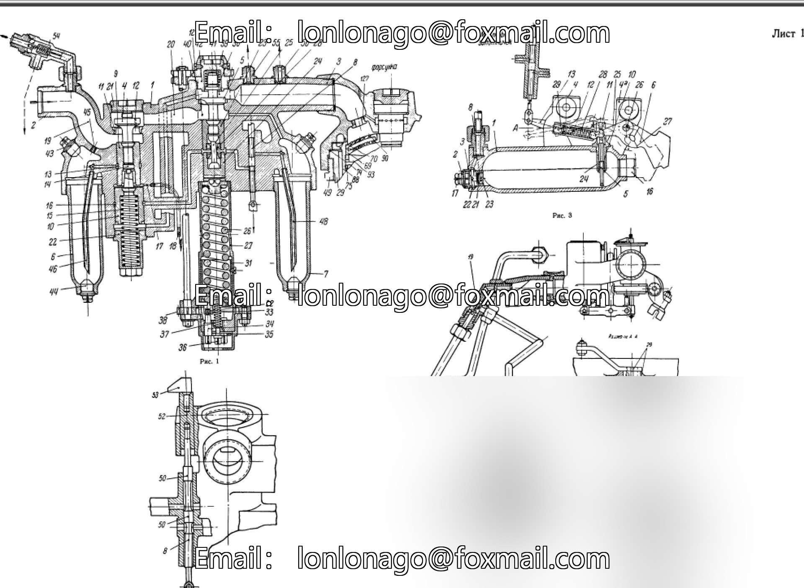

# Soviet Navy 53-38 Type torpedo technical drawing set, 1940 Moscow edition.

## Body

Union Naval 53-38 submarine torpedo technical drawing collection, 1940 Moscow edition.
1. Core content analysis
1. Overall structure of the torpedo
- Total length: 25 meters
- Diameter: 53 centimeters
- Uses electric propulsion system
- Includes active sonar detection equipment
2. Key component drawings
- Motor and reducer assembly
- Control system schematic
- Navigation system assembly drawing
- Battery group arrangement drawing
3. Technical parameters
- Maximum speed: 30 knots
- Cruise distance: 20 kilometers
- Maximum depth: 150 meters
4. Maintenance and inspection
- Regular inspection items
- Daily maintenance key points
- Troubleshooting guide
are copyable, and they are not returned after sale.

The set covers Soviet Navy 53-38 torpedo technical information, including the torpedo overall structure, key component drawings and technical parameters, along with specific dimensions and operating indicators.

<!-- AI_ENRICHED -->

## Images

## Payment

Here is a pay link on Stripe ( https://buy.stripe.com/3cs8yP7sY87d0vu9AB ). Please contact me lonlonago@foxmail.com after funding $89, and I will send you a complete data files , thank you!

